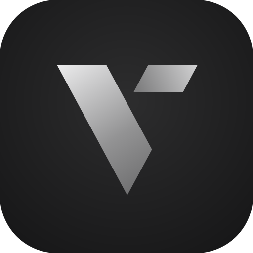

<p align="center">
  
</p>

<h1 align="center">Veyron</h1>

<p align="center">macOS on your iPhone and iPad, and on your computer's screen.</p>

<p align="center">
  <a href="#what-veyron-adds">What Veyron adds</a>
  ·
  <a href="#install">Install</a>
  ·
  <a href="#veyron-remote">Veyron Remote</a>
  ·
  <a href="docs/architecture.md">How it works</a>
  ·
  <a href="#credit">Credit</a>
</p>

<p align="center">
  <a href="https://github.com/Leviidev/Henge"></a>
  <a href="LICENSE"></a>
</p>

Veyron is a fork of [Henge](https://github.com/Leviidev/Henge) by Leviidev. Henge runs macOS on an iPhone or iPad; Veyron keeps all of that and adds a way to use that Mac from a computer, with a desktop app of its own, plus a few fixes found along the way.

## What Veyron adds

- **Veyron Remote** — an app for Linux, Windows and macOS that shows the Mac on a computer and drives it with that computer's mouse, keyboard and controller. It finds an iPhone on a cable by itself and a phone on the same Wi-Fi once that is allowed. See [Veyron Remote](#veyron-remote).
- **Streaming from the phone** — the Mac's screen goes through the phone's hardware encoder as H.264 or HEVC, with its sound. Quality, frame rate (30, 60 or 120) and picture size are set from the computer while connected. The phone can stop drawing the Mac on its own screen while it streams, and stay silent while the computer plays the sound.
- **Seamless mouse** — the pointer moves in and out of the Mac's window freely and the Mac's pointer follows it, through a USB tablet on the Mac's virtual USB bus. Left Ctrl + Left Alt locks the mouse to the Mac for games that turn with it.
- **Controller** — a controller on the computer appears in the Mac as a DualShock 4 on its USB bus, plugged in when a button is first pressed.
- **Shared clipboard with the computer** — copy on the computer and paste in the Mac, and back. It uses the same helper in the Mac as Henge's own sharing.
- **Shut Down and Restart from the app's menu** — they press the Mac's power button, so macOS closes its apps first. Force Off stays for when macOS is stuck.
- **A graphics fix for large meshes** — macOS's driver for the virtual GPU cuts the base vertex of an indexed draw to 16 bits, so meshes in a buffer of more than 65,536 vertices were drawn from the wrong ones. In Roblox that showed as spikes across the screen. Veyron's translator leaves the value whole. The match is against the driver in macOS 15.6.1.
- **A pointer fix** — an app's own pointer image that comes without premultiplied colour no longer has white specks around it.
- **Wallpapers that stay after a restart** — a picture of more than 64 MB keeps the list of its memory pages in two levels, and only one was read, so what the GPU drew of it never reached macOS. Every HEIC picture decodes through such a picture: the copy macOS saves of a wallpaper was black, and so were the desktop and the login screen after a restart.
- **One problem report for one panic** — macOS clears a stored panic log with a discard, which the Mac's auxiliary disk now accepts. Without it, "Your computer was restarted because of a problem" came back at every start.
- **Tools for looking into graphics** — a GPU inspector page (`tools/henge-inspect.py`) and a draw trace, both off unless switched on.
- **A new look** — charcoal and silver, after Veyron's mark, on the phone and on the computer.

Tested so far on an iPhone 17 Pro Max with a Linux computer, over USB. Wi-Fi is newer and less tried. Veyron Remote's Windows and macOS builds compile on every change but have not been run by anyone yet.

## What it does

All of this is Henge's work, carried over:

- **Own emulator** — iOS gives apps no hypervisor, so Veyron runs the Mac's arm64 code through its own JIT, with its own MMU and devices. It doesn't use QEMU or Virtualization.framework.
- **Installs on the device** — Veyron downloads Apple's restore image and restores it the way a Mac does. No Mac needed, and nothing is decrypted or patched.
- **Graphics** — macOS draws through a virtual GPU, and Veyron replays its commands with Metal. Safari and Electron apps like Discord draw on it.
- **Touch** — The screen is a Magic Trackpad 2: two fingers to scroll, and the Mac's own gestures work on it — three-finger swipes for Spaces and Mission Control and more. The volume buttons are its buttons: up clicks, down right-clicks, hold to drag. Esc, Tab, Control, Option and Command sit above the keyboard.
- **Keyboard and mouse** — On iPad, a Magic Keyboard or a Bluetooth keyboard and mouse drive the Mac directly.
- **External display** — During a Mac session, connect a display with a video-capable USB-C cable or a USB-C/HDMI dock. The mode activates automatically: the monitor shows the Mac, while the iPhone or iPad keeps its trackpad and keyboard controls. Disconnect to return the image to the device. The existing guest resolution is preserved. On iOS 17–26 the same happens through an older iOS route, not yet tried on hardware; outside a Mac session the display mirrors the device.
- **Sharing** — Copy and paste between macOS and the device, and a shared folder that shows up in Files and on the Mac.
- **Fits the screen** — On iPad, a new Mac gets a screen the shape of the iPad's, so there are no black bars.

## Install

Download the newest milestone from [Releases](https://github.com/rtllookupfunctionentry/Veyron/releases/latest): `Veyron-<version>.ipa`, or the `.tipa` for TrollStore.

A milestone collects many changes, so `main` is usually ahead of the newest one. Every change to `main` is built by GitHub Actions: for the newest build, open [Actions](https://github.com/rtllookupfunctionentry/Veyron/actions), choose the newest green **Build Veyron IPA** run, and download its artifact (GitHub asks you to be signed in, and keeps artifacts for 90 days). The file inside is still called `Henge.ipa`.

Sideload it with SideStore or AltStore, or install the `.tipa` with TrollStore or TrollStore Lite. iOS or iPadOS 17 or later, on an A14 or M1 chip or newer. iPad support comes from Henge, where it is new and has not run on a real iPad yet.

Veyron keeps Henge's bundle identifier. Installed over Henge and signed the same way, it takes Henge's place and keeps the Macs that are already installed. Deleting the app deletes its Macs.

- **JIT** is required: StikDebug, TrollStore (which stops at iOS 17.0), TrollStore Lite (which needs a jailbreak), a jailbreak on its own, or the built-in StikJIT helper (iOS 26 or later).
- **Storage:** about 43 GB free for macOS Sequoia. That's 17 GB for the download, which you can delete afterwards, and 26 GB for the Mac.
- **Memory:** a Mac gets 4, 6 or 8 GB. Sign Veyron with the increased memory limit entitlement if your certificate has it.

Then open the Install tab, pick macOS Sequoia 15.6.1, and keep Veyron open with the device plugged in. Tahoe 26.6.2 and macOS 27.2 are offered too. Sonoma 14.6.1 and Ventura 13.6 are smaller downloads (14.1 and 12.3 GB) for devices short on storage. Monterey isn't offered yet: it installs, but its desktop never appears.

## Veyron Remote

The desktop app, in [`remote/`](remote). It shows the Mac in a window and sends it the computer's mouse, keyboard and controller.

**Get it.** Each milestone in [Releases](https://github.com/rtllookupfunctionentry/Veyron/releases/latest) has a package for each system. For changes made since, the newest green **Build Veyron Remote** run in [Actions](https://github.com/rtllookupfunctionentry/Veyron/actions) has one artifact for each system.

- **Linux:** unpack and run `install.sh`. The package is built on Ubuntu 24.04 and uses the system's FFmpeg 6 (`libavcodec.so.60`) and glibc 2.38 or later; on a system with another FFmpeg, build from source with `remote/install.sh`, which needs Rust, SDL3 and FFmpeg with their development files. Phones on a cable need `usbmuxd` running. A tray icon needs `libayatana-appindicator`.
- **Windows:** unpack and run `veyron-remote.exe`; FFmpeg's libraries come with it. Phones on a cable need Apple's device support, which comes with iTunes or the Apple Devices app.
- **macOS:** `brew install ffmpeg sdl3` first; the package uses Homebrew's FFmpeg 8 and SDL3. It is not notarised: after unpacking, run `xattr -d com.apple.quarantine veyron-remote/veyron-remote`.

**Use it.**

1. On the phone, start a Mac, open Details and turn on **Stream to a computer**.
2. Plug the phone into the computer and open Veyron Remote. The phone appears under Nearby; press Connect.
3. Move the pointer over the picture and use the Mac. The bar with full screen, statistics, settings and disconnect opens from the small grip at the top edge.

Over Wi-Fi, also turn on **Allow over Wi-Fi** on the phone. The phone then appears under Nearby on the same network, and can also be reached by typing its address. For a new computer, tap **Pair a Computer** on the phone (switching Wi-Fi on does it too) and connect within two minutes: the phone and the computer each show a six-digit number, and if it is the same on both, press Pair on the phone and They match on the computer. After that the computer connects with one click. Paired computers can be forgotten on the phone, and paired phones in the app's settings.

| Key | What it does |
| --- | --- |
| Left Ctrl + Left Alt | Locks the mouse to the Mac, for games; again to let it go |
| F11 | Full screen |
| Super (Windows key) | Command in the Mac. "Alt is Command" in Settings swaps the two, as on a Mac keyboard |

Settings hold the stream's quality, frame rate, size and format, sound and volume, the seamless mouse, the controller, the shared clipboard, connecting by itself when a phone is plugged in, and starting at login. The statistics show frames a second, bit rate, the decoder in use, decoding time, how far behind the Mac the picture is, and the ping.

Pictures are decoded on the graphics card where FFmpeg can (VA-API, Vulkan, D3D11, VideoToolbox) and shown the moment they are ready. If the connection drops, the app connects again by itself.

## Sharing with the Mac

Do this once for each Mac: open Terminal on the Mac, then in Veyron open Details and tap **Type the Set Up Command**. Press Return on the Mac, and choose Allow when macOS asks about `henge-agent` and local networks. It needs the Mac's keyboard layout to be U.S.

Then a Henge folder in the Mac's home folder is the same folder as Files › Veyron › Shared. What you copy on the Mac is copied on the device too, and the paste button pastes from the device into the Mac. The helper and the folder inside the Mac keep Henge's name.

## Known limits

- Signing in to an Apple Account inside macOS fails with a verification error.
- Rosetta cannot be installed in the Mac: macOS reports that the platform does not support it.
- A wallpaper or login screen that went black under an earlier build stays black until the copies macOS saved are removed once. In Terminal inside the Mac: `rm -rf ~/Library/Containers/com.apple.wallpaper.agent/Data/Library/Caches/com.apple.wallpaper.caches/extension-*/*`, then `sudo rm -f /private/var/db/Wallpapers/*/Metadata.plist /private/var/db/Wallpapers/*/Wallpaper.png`, then `killall WallpaperAgent`.
- Graphics are tested on macOS's own apps, Chrome, Firefox, VS Code, Discord and Roblox. Other apps may draw wrongly.
- On macOS Sonoma, the login screen and the account picture can be green: choose the wallpaper again in System Settings › Wallpaper (another one, then yours) and the picture in Users & Groups. Switching to a dynamic wallpaper (such as Sonoma) can stop the screen updating. On Ventura, the Calendar icon in the Dock is missing its date.
- For the first few minutes after you log in, macOS is busy starting up in the background, so apps open more slowly.
- Only one Mac can start per launch. Quit Veyron and open it again to start another, and to start one again after restarting or shutting down macOS.
- iPadOS keeps some keyboard shortcuts for itself, such as Command-Tab.
- A macOS update inside the Mac can change the graphics driver the large-mesh fix matches. The log then says the driver's base vertex cut was not found.
- It's emulation, so it runs slower than a real Mac.

## Screenshots

<table>
  <tr>
    <td align="center" colspan="3"><br><sub>iPad</sub></td>
  </tr>
  <tr>
    <td align="center" width="33%"><br><sub>Macs</sub></td>
    <td align="center" width="33%"><br><sub>Trackpad</sub></td>
    <td align="center" width="33%"><br><sub>Install macOS</sub></td>
  </tr>
</table>

<sub>Henge's own screenshots, from before Veyron's charcoal and silver: the screens are laid out the same.</sub>

## Building

On a Mac with Xcode 27 or later and `xcodegen`. Veyron takes StikJIT, on-device pairing, libslirp and glib from a built [Husk](https://github.com/Leviidev/Husk) checkout at `~/Documents/Coding/Husk` (set `HUSK` to use another path):

```bash
ios/scripts/fetch_deps.sh
tools/build_ios_restore.sh
make ios-lib
ios/scripts/package_ipa.sh
```

That produces `~/Desktop/Henge.ipa`, and `package_ipa.sh --trollstore` writes `Henge.tipa`.

`make` builds the engine for the Mac, `build/hengevm`, and `make test` runs its tests. Veyron Remote builds with `cargo build --release` in `remote/`.

Inside the code, names still say Henge: functions, log lines, the bundle identifier, the `_henge._tcp` network service, file names. They are left alone so that Henge's changes keep merging in.

## Credit

Veyron exists because of [Henge](https://github.com/Leviidev/Henge), written by [Leviidev](https://itslevii.dev). The emulator and its JIT, the installer, the virtual GPU and its Metal replay, the trackpad, external displays, sharing and the app around them are Henge's. If you want macOS on an iPhone without the remote desktop, use Henge: it has releases and an update source for SideStore and AltStore.

Henge in turn builds on [Husk](https://github.com/Leviidev/Husk), StikJIT, libslirp and usbmuxd. Veyron Remote uses SDL, FFmpeg and egui, and carries the Inter typeface (SIL Open Font License) and Phosphor icons (MIT).

## Licence

GPL-2.0-or-later, as Henge is. Veyron compiles in usbmuxd (GPLv2 or GPLv3) and code from Husk (GPL-2.0-or-later), so the shipped binary is a combined GPL work. It cannot go on the App Store. See [docs/licensing.md](docs/licensing.md).

macOS and the Mac's boot ROM are Apple's and aren't part of Veyron. Veyron downloads both from Apple when you install.
